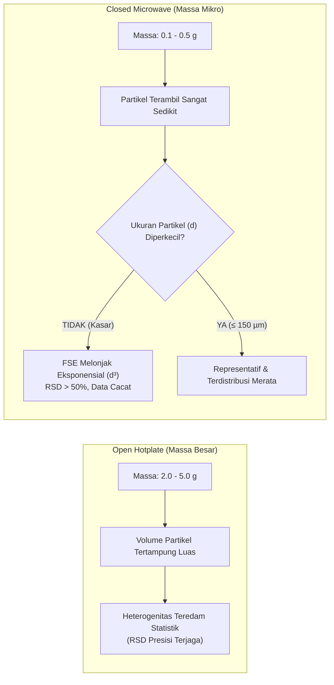

# ⚗️ Mengapa Sampel Wajib Sangat Homogen pada Closed-Vessel Microwave Digestion?

> **Intisari Mental Model:**  
> Pada destruksi bejana terbuka (*open hotplate*), analis dapat menimbang 2–5 gram sampel sehingga heterogenitas lokal teredam secara statistik.  
> Pada destruksi gelombang mikro bejana tertutup (*closed-vessel microwave*), massa sampel **dibatasi ketat hanya 0.1–0.5 gram** untuk mencegah ledakan gas.  
> Pengurangan massa hingga puluhan kali lipat ini memicu **dua konsekuensi tak terhindarkan**:  
> 1. Secara **metrologi statistik**, varians kesalahan sampling (*Fundamental Sampling Error*) meledak kecuali ukuran partikel diperkecil drastis.  
> 2. Secara **termodinamika bejana**, gumpalan pekat tak homogen memicu lonjakan eksotermik kilat ($\frac{dP}{dt}$) dan *blind-spot* pada sensor kontrol bejana referensi.

---

## 1. Pilar Metrologi: Teori Sampling Pierre Gy & Paradoks Sub-Gram

Pengambilan acak (*random sampling*) hanya absah jika setiap partikel memiliki probabilitas yang sama untuk terambil. Ketika massa penimbangan dipangkas ke skala sub-gram, hukum fisika statistik mendikte keharusan homogenisasi.

Berdasarkan **Teori Pengambilan Sampel Pierre Gy (*Gy’s Theory of Sampling / TOS*)**, varians kesalahan fundamental pengambilan sampel (*Fundamental Sampling Error / FSE*) dirumuskan sebagai:

$$s_{\text{FSE}}^2 = \frac{C \cdot d^3}{M_s}$$

Di mana:
* $s_{\text{FSE}}^2$ = varians kesalahan sampling fundamental (presisi data analitik).
* $C$ = konstanta sampling material (karakteristik densitas, faktor bentuk, dan mineralogi matriks).
* $d$ = diameter partikel terbesar (*maximum particle diameter*).
* $M_s$ = massa sampel yang ditimbang ke dalam bejana destruksi.



### Implikasi Matematis ($d \propto \sqrt[3]{M_s}$):
Jika $M_s$ diturunkan dari 2.5 g ke 0.25 g (faktor penurunan $10\times$), maka untuk menjaga presisi dan varians sampling ($s_{\text{FSE}}^2$) yang identik, diameter partikel ($d$) wajib diperkecil hingga $\sqrt[3]{10} \approx 2.15$ kali lebih halus. 

Jika sampel kasar tetap ditimbang pada $0.2\text{ g}$, variasi antar-replikat ($n=3$) akan menghasilkan %RSD liar yang sering disalahartikan sebagai ketidakstabilan instrumen ICP-MS, padahal merupakan **kesalahan sampling primer (*sampling error*)**.

---

## 2. Pilar Termodinamika & Kinetika: Lonjakan Tekanan ($\frac{dP}{dt}$)

Pada sistem bejana tertutup bertekanan tinggi (hingga 40–100 bar), homogenitas adalah prasyarat **keselamatan fisik laboratorium (*physical explosion safety*)**.

```
Partikel Kasar / Kantung Organik Pekat
   │
   ▼ (Suhu mencapai ambang aktivasi oksidasi: ~140 - 160 °C)
Dekomposisi Eksotermik Kilat (Local Hotspot)
   │
   ▼
Pelepasan Gas Stoikiometrik Mendadak (CO₂ ↑ + NOₓ ↑)
   │
   ▼
Spike Kenaikan Tekanan Ekstrem (dP/dt) melampaui Disipasi Termal
   │
   ▼
Pecahnya Cakram Pengaman (Rupture Disk Blowout) / Venting Darurat
```

### Reaksi Gas Stoikiometrik:
$$\text{C}_n\text{H}_m + x\text{HNO}_3 \xrightarrow{\Delta, P} n\text{CO}_2 \uparrow + \frac{m}{2}\text{H}_2\text{O} + y\text{NO}_x \uparrow + \Delta H_{\text{reaksi}}$$

1. **Rasio Luas Permukaan ($A/V$):**  
   Partikel seragam memiliki rasio luas permukaan kontak yang merata terhadap $\text{HNO}_3$. Partikel heterogen (campuran debu halus dan bongkahan padat) menyebabkan degradasi tidak bertahap: fraksi halus larut seketika di suhu rendah, sedangkan bongkahan padat meledak reaktif saat suhu melampaui ambang aktivasi redoks.
2. **Kantung Eksotermik Lokal (*Localized Organic Pockets*):**  
   Jika cuplikan $0.2\text{ g}$ secara acak mengambil satu fragmen lipid, karbohidrat, atau serat pekat, pelepasan gas $\text{CO}_2$ dan $\text{NO}_x$ secara serentak menciptakan laju lonjakan tekanan ($\frac{dP}{dt}$) yang melampaui ambang mekanik bejana PTFE/TFM.

---

## 3. Pilar Arsitektur Microwave: Blind-Spot Sensor Bejana Referensi

Mayoritas rotor microwave laboratorium mengandalkan **satu bejana referensi (*Reference Vessel*)** yang dilengkapi sensor suhu dan tekanan (atau pemindai optik IR di bagian bawah rotor).

* Magnetron mengatur output daya gelombang mikro (watt) berdasarkan umpan balik (*feedback loop*) dari bejana kontrol ini.
* **Skenario Bahaya Heterogenitas Lintas Bejana:**
  * Jika **Bejana Kontrol** memuat fraksi sampel berkadar organik rendah (kenaikan suhu landai), komputer microwave memerintahkan magnetron menembakkan daya penuh (1000–1500 W).
  * Jika **Bejana No. 6** (tanpa sensor) memuat bongkahan organik pekat akibat sampel tidak homogen, bejana tersebut akan mengalami *thermal runaway* tanpa disadari oleh instrumen.
  * Hasilnya: Bejana No. 6 meledak, merusak ulir bejana TFM dan *sleeve* komposit PEEK.

---

## 4. Studi Kasus Riil: Matriks Glikoprotein Sarang Burung Walet (*EBN*)

Sarang walet adalah matriks protein dan karbohidrat padat ($\sim 50\text{–}60\%$ glikoprotein). Kontaminasi logam berat ($\text{Pb, As, Hg, Cd}$) terkonsentrasi tidak merata antara bagian **mangkok (*cup*)** dengan **kaki sarang (*foot*)** yang menempel langsung pada dinding semen atau kayu rumah walet.

### Simulasi Neraca Massa: Ledakan Eror 600%
Analis menimbang $M_s = 0.20\text{ g}$ serbuk sarang walet:
* $95\%$ ($0.19\text{ g}$) adalah serat saliva bersih dengan kadar $\text{Pb} = 0.05\,\text{mg/kg}$ (50 ppb).
* $5\%$ ($0.01\text{ g}$) adalah satu pecahan kecil bagian kaki sarang berkadar $\text{Pb} = 5.00\,\text{mg/kg}$ (5000 ppb).

$$\text{Massa Pb} = (0.19\text{ g} \times 0.05\,\mu\text{g/g}) + (0.01\text{ g} \times 5.00\,\mu\text{g/g}) = 0.0595\,\mu\text{g}$$
$$[\text{Pb}]_{\text{terukur}} = \frac{0.0595\,\mu\text{g}}{0.20\text{ g}} = \mathbf{0.298\,\text{mg/kg}}$$

| Pengujian Replikasi | Komposisi yang Terambil | Hasil Pembacaan Pb | Status Regulasi (Batas $\le 0.1\,\text{mg/kg}$) |
| :--- | :--- | :---: | :---: |
| **Replikasi 1** | Memuat 5% pecahan kaki | **$0.30\,\text{mg/kg}$** | **DITOLAK (Tercemar)** |
| **Replikasi 2** | Hanya serat saliva bersih | **$0.05\,\text{mg/kg}$** | **LOLOS (Memenuhi Syarat)** |

> **Dampak Metrologi:**  
> Selisih konsentrasi sebesar **$600\%$** ini murni akibat kegagalan homogenisasi partikel $0.01\text{ g}$. Data kehilangan integritas hukum (*legally invalid*).

### Masalah Fisik Kinetika: *Undigested Core*
Glikoprotein kering bersifat tanduk (*horn-like*). Pada bongkahan tak homogen, lapisan luar yang teroksidasi membentuk lapisan gel pelindung (*diffusion barrier*) yang menghambat asam segar menembus inti dalam. Sisa partikel gosong (*charred carbon*) menjebak analit logam, menurunkan angka perolehan kembali (*recovery* rendah pada ICP-MS).

### Penanganan Khusus Sarang Walet: *Cryogenic Grinding*
Glikoprotein bersifat elastis/viskoelastis. Blender pisau putar konvensional menghasilkan panas gesekan yang justru membuat serat walet melunak dan menggumpal.
* **Prosedur Baku:** Sampel dikeringkan beku (*freeze-drying*), lalu digerus menggunakan **Penggilingan Kriogenik (*Cryomill*)** dengan nitrogen cair ($-\!196^\circ\text{C}$). 
* Pada suhu ini, matriks glikoprotein berada di bawah titik transisi gelas (*glass transition temperature*), menjadi sangat getas (*brittle*), dan mudah dijadikan tepung halus homogen $\le 100\,\mu\text{m}$.

---

## 5. Invarian Praktis Laboratorium

1. **Ambang Ukuran Partikel:**  
   Sampel padat wajib digerus hingga lolos saringan **100 mesh ($\le 150\,\mu\text{m}$)** sebelum penimbangan mikro $0.1–0.3\text{ g}$.
2. **Pencegahan Stratifikasi Gravitasi:**  
   Untuk sampel bubuk campuran (fraksi mineral berat vs serat organik ringan), botol sampel wajib dihomogenkan kembali (*tumble/shake*) sesaat sebelum spatula menimbang.
3. **Kepatuhan Batas Organik:**  
   Kandungan bahan organik murni tidak boleh melebihi $0.25\text{ g}$ per bejana TFM standar untuk mencegah lonjakan $\frac{dP}{dt}$.

---

## 📚 Referensi Otoritatif

1. **Gy, Pierre** (1998). *Sampling for Analytical Purposes*. John Wiley & Sons. ISBN: 978-0-471-97940-1.
2. **Pitard, Francis F.** (2019). *Theory of Sampling and Sampling Practice (3rd Edition)*. CRC Press.
3. **US EPA Method 3051A** (2007). *Microwave Assisted Acid Digestion of Sediments, Sludges, Soils, and Oils*. Revision 1.
4. **US EPA Method 3052** (1996). *Microwave Assisted Acid Digestion of Siliceous and Organically Based Matrices*.
5. **Kingston, H. M., & Haswell, S. J.** (1997). *Microwave-Enhanced Chemistry: Fundamentals, Sample Preparation, and Applications*. ACS Professional Reference Book.
6. **Milestone / CEM / Anton Paar Technical Application Notes** on *Safe Microwave Digestion of Organic and Biological Matrices*.
